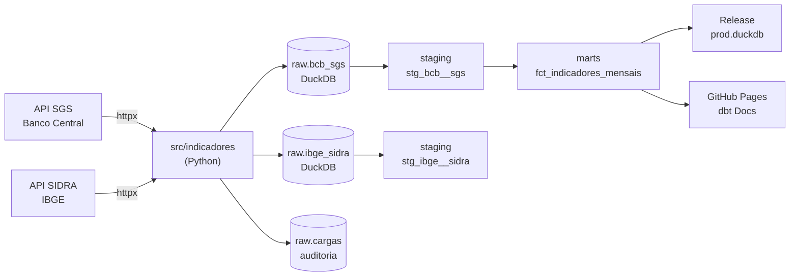
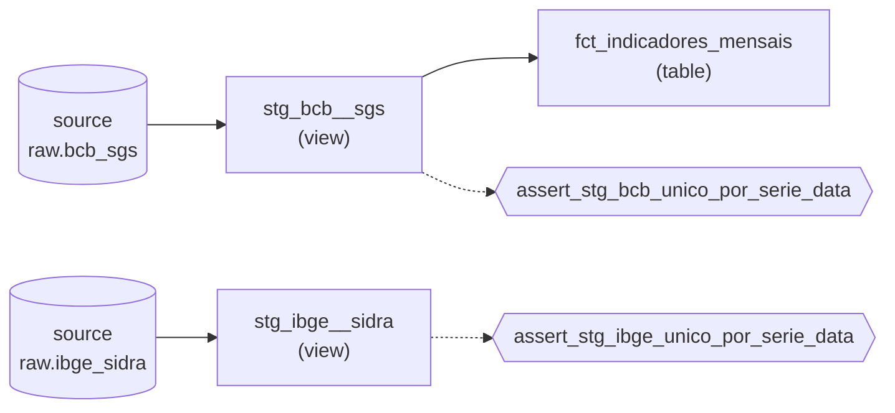
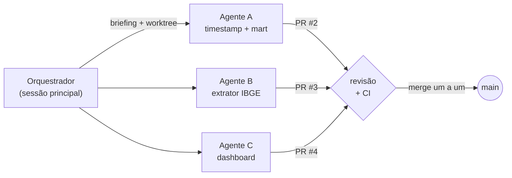

# Indicadores Econômicos do Brasil — Python + dbt + DuckDB

[](https://github.com/Jones51/indicadores-br/actions/workflows/dbt_build.yml)



Pipeline público de indicadores macroeconômicos do Brasil (Selic, IPCA e dólar PTAX), extraídos do
SGS do Banco Central, modelados com dbt e atualizados automaticamente a cada push (ingestão
incremental, reconciliada toda semana com uma carga completa).

- Ingere as séries do BCB em Python e modela em marts testados e documentados
- Publica o site de documentação e o warehouse pronto — aberto a qualquer pessoa, sem credenciais
- Roda sozinho no GitHub Actions: a cada push na `main` e toda segunda-feira

> **IBGE (SIDRA)** já é ingerido até a camada staging (desocupação PNAD e PIB trimestral,
> [ADR 0004](docs/adr/0004-extrator-ibge-sidra.md)); a junção ao mart está no [Roadmap](#-roadmap).

| O que construí | Como implementei | Onde olhar |
| --- | --- | --- |
| **Ingestão** | extrator por fonte, parsing puro separado do HTTP, carga **incremental** com margem de revisão, idempotente e auditada | [`src/indicadores/`](src/indicadores/) · [ADR 0006](docs/adr/0006-ingestao-incremental.md) |
| **Segurança dos dados** | estado validado, reconciliação semanal "full vence", portão dbt, backup e rollback do warehouse | [Produção](#-produção) |
| **Pipeline dbt** | sources → `staging/` → `marts/` | [`transform/models/`](transform/models/) |
| **Testes de dados** | teste de grão (`unique` / teste singular) + `not_null` nas chaves | [`_marts.yml`](transform/models/marts/_marts.yml) |
| **dbt Docs hospedado** | linhagem (inclusive por coluna), descrições, testes | [Site de docs](https://jones51.github.io/indicadores-br/) |
| **Dashboard público** | HTML estático + D3, alimentado por um JSON que a CI exporta do mart | [Dashboard](https://jones51.github.io/indicadores-br/dashboard/) |
| **CI pública** | lint + testes + build + publicação a cada push | [Workflow](https://github.com/Jones51/indicadores-br/actions) |
| **Ambientes** | `dev` local vs `prod` na CI | [`ci/profiles.yml`](ci/profiles.yml) |
| **Warehouse publicado** | um `ATTACH`, consultável por qualquer um | [Consultar](#-consultar-o-warehouse-publicado) |
| **Decisões de arquitetura** | ADRs numerados | [`docs/adr/`](docs/adr/) |
| **Agentes em paralelo** | subagentes em git worktrees, PR por agente, integração revisada | [Como foi feito](#-desenvolvimento-com-agentes-em-paralelo) |

---

## ⚙️ O pipeline dbt

As séries brutas passam por três camadas — source declarada → view de staging tipada → mart
mensal — com testes barrando cada build. O DAG completo:



| Camada | Modelo | Grão | Materialização |
| --- | --- | --- | --- |
| Source | `raw.bcb_sgs` | uma linha por (série, data), formato longo | tabela (carga Python) |
| Source | `raw.ibge_sidra` | uma linha por (série, período), formato longo | tabela (carga Python) |
| Source | `raw.cargas` | uma linha por (execução, série, modo): auditoria da ingestão | tabela (carga Python) |
| Source | `raw.reconciliacoes` | uma linha por (execução, série): reconciliação incremental × full | tabela (carga Python) |
| Staging | `stg_bcb__sgs` | uma linha por (série, data), tipada | view |
| Staging | `stg_ibge__sidra` | uma linha por (série, data), tipada | view |
| Marts | `fct_indicadores_mensais` | uma linha por mês, uma coluna por indicador | table |

Colunas do mart:

| Coluna | Descrição |
| --- | --- |
| `mes_referencia` | primeiro dia do mês (chave) |
| `selic_meta_aa` | meta Selic vigente no último dia do mês (% a.a.) |
| `ipca_mensal` | variação mensal do IPCA (%); nulo no mês corrente até a divulgação |
| `ipca_12m` | IPCA acumulado em 12 meses (%); nulo no mês corrente até a divulgação |
| `juro_real_ex_post_aa` | Selic meta descontada do IPCA 12m pela equação de Fisher (% a.a.); nulo se faltar insumo |
| `dolar_ptax_medio` | média mensal da PTAX venda (R$/US$) |
| `dolar_ptax_fim_mes` | PTAX venda do último dia útil do mês (R$/US$) |

E os recursos do dbt que fazem o trabalho:

| Recurso do dbt | Como usei |
| --- | --- |
| Sources declaradas (sem caminhos fixos no SQL) | [`_sources.yml`](transform/models/staging/_sources.yml) + `source('raw', 'bcb_sgs')`, com `freshness` de 8 dias |
| Dependências entre modelos | `ref()` em tudo a jusante; o dbt resolve ordem e paralelismo |
| Materializações | por pasta no [`dbt_project.yml`](transform/dbt_project.yml): `staging/` → `view`, `marts/` → `table` |
| Testes de dados | `unique` + `not_null` em `mes_referencia`; `accepted_values` nos nomes de série; teste singular de unicidade por (série, data) ([`assert_stg_bcb_unico_por_serie_data`](transform/tests/assert_stg_bcb_unico_por_serie_data.sql)) |
| Análise estática | `+static_analysis: strict`: SQL validado na compilação, linhagem por coluna no Docs v2 |
| Schemas customizados | macro [`generate_schema_name`](transform/macros/generate_schema_name.sql): `staging` e `marts` sem prefixo do target |
| Ambientes | `dev` local ([`transform/profiles.yml`](transform/profiles.yml)) vs `prod` na CI ([`ci/profiles.yml`](ci/profiles.yml)) |

`dbt build` compila o SQL, materializa os modelos e falha se qualquer teste falhar — o mesmo comando
local e na CI.

---

## 🚀 Produção

O GitHub Actions roda o pipeline inteiro, sem depender de máquina local:
[`.github/workflows/dbt_build.yml`](.github/workflows/dbt_build.yml). A CI tem **estado**: o
`prod.duckdb` publicado na release é o ponto de partida da execução seguinte
([ADR 0006](docs/adr/0006-ingestao-incremental.md)).

| Gatilho | Ingestão | Reconciliação full-vence | Publica |
| --- | --- | --- | --- |
| Pull request | incremental sobre o `prod.duckdb` (só leitura) | sim (valida o caminho do agendamento) | não |
| Push na `main` | incremental | não | sim |
| Semanal (segunda-feira) | incremental | **sim**: o full é publicado | sim |
| Manual (`workflow_dispatch`) | `modo: incremental` ou `full` | se marcar `reconciliar` | sim |

Em cada execução, o Actions:

1. Instala as dependências (`uv`, driver `dbc`) e roda `ruff` e `pytest`
2. **Baixa e valida o estado** (`indicadores validar`): para servir de base incremental, o
   `prod.duckdb` da release precisa abrir no DuckDB, ter as tabelas raw com o schema esperado e
   nenhuma chave duplicada. Se **abrir mas for inválido** (ex.: schema de uma versão anterior), a
   carga vira full, o banco novo herda o histórico de auditoria e o arquivo ainda é usado como
   backup. Se estiver **corrompido**, a carga vira full e o backup existente é preservado. Se a
   release não tiver o arquivo, cada série vira full sozinha. Se a consulta à release falhar, o
   run para
3. **Ingere** (`indicadores ingest`): cada série recomeça um pouco antes da última data
   carregada (90 dias nas diárias, 2 períodos nas mensais e trimestrais) e substitui essa
   janela, numa transação que também grava a linha de auditoria em `raw.cargas`
4. **Reconcilia** (segundas e PRs): carga full num banco separado e comparação série a série e
   linha a linha (`indicadores reconciliar`). Revisão da fonte é registrada e o full vence.
   Divergência estrutural (série sumiu, data regrediu, contagem caiu mais de 1%) **falha o run**
5. **Portão**: `dbt build` e `dbt source freshness` precisam passar
6. **Publica** (só na `main`): sobe o `prod.duckdb` anterior como `prod.anterior.duckdb`
   (backup) e depois o novo `prod.duckdb` na release [`warehouse`](https://github.com/Jones51/indicadores-br/releases/tag/warehouse)
7. Gera o dbt Docs e o dashboard (`indicadores exportar`) e publica no GitHub Pages

Se qualquer passo antes da publicação falhar, o warehouse publicado continua o mesmo.

### Acompanhar uma execução

O **resumo do run** (aba *Summary* da execução no Actions) mostra o estado inicial usado, uma
tabela por série (modo, motivo, última data antes → depois, linhas recebidas, removidas e
inseridas) e, quando há reconciliação, o relatório dela, com exemplos de linhas divergentes.
O badge no topo deste README leva às últimas execuções.

O histórico fica no próprio warehouse publicado:

```sql
-- últimas execuções: modo e volume por fonte
SELECT execucao_id, fonte, modo, motivo, count(*) AS series,
       sum(linhas_recebidas) AS recebidas, max(executado_em) AS executado_em
FROM raw.cargas
GROUP BY ALL
ORDER BY executado_em DESC
LIMIT 20;

-- divergências encontradas pela reconciliação semanal
SELECT execucao_id, serie_nome, situacao, detalhe
FROM raw.reconciliacoes
WHERE situacao <> 'igual'
ORDER BY executado_em DESC;
```

### Rollback do warehouse

Cada publicação guarda a versão anterior como `prod.anterior.duckdb` na mesma release:

| `prod.duckdb` anterior | `validar` | Backup |
| --- | --- | --- |
| válido | 0 | vira `prod.anterior.duckdb` |
| abre, mas inválido como base (ex.: schema de uma versão anterior do código) | 3 | **vira** `prod.anterior.duckdb`: foi publicado depois de passar no `dbt build` |
| corrompido (não abre no DuckDB) | 4 | não; o `prod.anterior.duckdb` existente é preservado |

Para voltar à versão anterior (requer `gh` autenticado com permissão de escrita no repositório):

```powershell
gh release download warehouse -p prod.anterior.duckdb -O prod.duckdb --clobber
uv run indicadores validar --db prod.duckdb      # 0 ou 3: abre; 4: corrompido, não publicar
gh release upload warehouse prod.duckdb --clobber
```

Restaurar um backup de schema antigo (saída 3) é seguro: o próximo run faz full, herda o
histórico de `raw.cargas`/`raw.reconciliacoes` e guarda esse mesmo arquivo como backup.
Com saída 0, o próximo run parte do warehouse restaurado. O dbt Docs e o dashboard do Pages continuam com a
versão do último run até o próximo, que pode ser disparado na aba Actions (*Run workflow*). Use
`modo: full` para reconstruir do zero.

---

## 🦆 Consultar o warehouse publicado

Sem clonar nada. [Instale o DuckDB](https://duckdb.org/docs/installation/) **2.x** (o arquivo usa o
formato de armazenamento do DuckDB 2.0) — no Windows, `winget install DuckDB.cli` — e, numa sessão
`duckdb`:

```sql
INSTALL httpfs;
LOAD httpfs;

ATTACH 'https://github.com/Jones51/indicadores-br/releases/download/warehouse/prod.duckdb' AS indicadores;
USE indicadores;
SHOW ALL TABLES;

SELECT * FROM marts.fct_indicadores_mensais ORDER BY mes_referencia DESC LIMIT 12;
```

---

## 📖 Docs

A documentação é gerada com `dbt docs generate` (dbt Docs v2) e publicada no GitHub Pages:

**→ [https://jones51.github.io/indicadores-br/](https://jones51.github.io/indicadores-br/)**

O site mostra:

- O **grafo de linhagem** completo (source → staging → marts), inclusive **por coluna**
- **Descrições** de modelos e colunas vindas do YAML
- Quais colunas têm **testes**

O **dashboard** (KPIs e gráficos de Selic, IPCA, juro real e dólar) é publicado no mesmo site,
a partir de um JSON exportado do mart pela CI ([ADR 0005](docs/adr/0005-dashboard-estatico-pages.md)):

**→ [https://jones51.github.io/indicadores-br/dashboard/](https://jones51.github.io/indicadores-br/dashboard/)**

---

## 💻 Rodar localmente

Requer [uv](https://docs.astral.sh/uv/). No PowerShell:

```powershell
uv sync                                   # cria .venv e instala dependências
uvx dbc sync --level user                 # driver DuckDB 2.x usado pelo dbt v2 (uma vez por máquina)
uv run indicadores ingest                 # incremental: só a janela recente de cada série (banco vazio = full)
uv run indicadores ingest --full          # recarga completa desde 2010
cd transform
uv run dbt build --profiles-dir .         # modelos + testes (target dev)
```

Docs localmente:

```powershell
cd transform
uv run dbt compile --profiles-dir . --static-analysis strict --generate-info-schema
uv run dbt docs generate --profiles-dir . --no-compile
uv run dbt docs serve --profiles-dir . --port 8080
```

Dashboard localmente (abra http://localhost:8000):

```powershell
uv run indicadores exportar                    # grava dashboard/dados.json a partir do mart
uv run python -m http.server -d dashboard 8000
```

Validação de estado e reconciliação, com os mesmos comandos da CI:

```powershell
uv run indicadores validar --db data/warehouse.duckdb    # 0 válido, 3 abre mas inválido, 4 corrompido
$env:DUCKDB_PATH = "data/full.duckdb"; uv run indicadores ingest --full; Remove-Item Env:DUCKDB_PATH
uv run indicadores reconciliar --base data/warehouse.duckdb --full data/full.duckdb   # 2 = estrutural
uv run indicadores resumo                                # tabela da última execução em raw.cargas
```

Explorar o warehouse local na UI do DuckDB (somente leitura):

```powershell
duckdb -ui -cmd "ATTACH 'data/warehouse.duckdb' AS warehouse (READ_ONLY); USE warehouse;"
```

---

## 📊 Séries

| Nome | Código SGS | Unidade | Periodicidade |
| --- | --- | --- | --- |
| `selic_meta` | 432 | % a.a. | diária |
| `ipca_mensal` | 433 | % a.m. | mensal |
| `ipca_12m` | 13522 | % 12 meses | mensal |
| `dolar_ptax_venda` | 1 | R$/US$ | diária |

IBGE (SIDRA), nível Brasil. Datas = primeiro dia do último mês do período
([ADR 0004](docs/adr/0004-extrator-ibge-sidra.md)):

| Nome | Tabela / variável | Unidade | Periodicidade |
| --- | --- | --- | --- |
| `desocupacao` | 4099 / 4099 | % | trimestral |
| `desocupacao_movel` | 6381 / 4099 | % | trimestre móvel (mensal) |
| `pib_indice_sa` | 1621 / 584 (PIB a preços de mercado) | índice dessaz. (1995=100) | trimestral |
| `pib_var_interanual` | 5932 / 6561 (PIB a preços de mercado) | % s/ mesmo tri do ano anterior | trimestral |

Nova série = nova entrada em `SERIES_BCB` ou `SERIES_IBGE` ([`config.py`](src/indicadores/config.py)).
`uv run indicadores ingest --fonte ibge` ingere só uma fonte.

---

## 📁 Estrutura

```text
.
├── .github/workflows/dbt_build.yml   # CI pública: lint, testes, build, publicação
├── ci/profiles.yml                   # target prod do DuckDB para o Actions
├── dashboard/index.html              # dashboard estático (lê dados.json exportado do mart)
├── data/                             # warehouses locais (gitignored; a CI regenera)
├── docs/adr/                         # decisões de arquitetura (ADRs)
├── src/indicadores/
│   ├── config.py                     # caminhos e catálogo de séries
│   ├── extract/                      # um módulo por fonte (bcb, ibge)
│   ├── incremental.py                # janela incremental (funções puras)
│   ├── ingestao.py                   # orquestra janela -> extração -> carga + auditoria
│   ├── load.py                       # carga na raw (substituição por intervalo) e raw.cargas
│   ├── estado.py                     # validação do warehouse herdado (`indicadores validar`)
│   ├── reconciliar.py                # reconciliação incremental x full
│   └── cli.py                        # `indicadores ingest | validar | reconciliar | resumo | exportar`
├── tests/                            # testes unitários (sem rede)
├── transform/                        # projeto dbt
│   ├── dbt_project.yml
│   ├── models/
│   │   ├── staging/                  # _sources.yml, stg_bcb__sgs, stg_ibge__sidra (views)
│   │   └── marts/                    # fct_indicadores_mensais + testes (tables)
│   ├── macros/                       # generate_schema_name
│   └── tests/                        # testes singulares
└── dbc.toml                          # driver ADBC do DuckDB fixado para o dbt v2
```

---

## 🤖 Desenvolvimento com agentes em paralelo

Este projeto também é um estudo de **desenvolvimento agêntico**: várias funcionalidades foram
construídas por subagentes do Claude Code trabalhando **ao mesmo tempo**, cada um na sua
[git worktree](https://git-scm.com/docs/git-worktree) e branch, com um agente orquestrador
planejando, revisando e integrando. O processo completo está em [`CLAUDE.md`](CLAUDE.md#desenvolvimento-com-agentes-em-paralelo).



| Etapa | Como foi feito |
| --- | --- |
| **Planejamento** | tarefas divididas por área de código, com mapa de conflitos e números de ADR reservados |
| **Isolamento** | uma worktree por agente, irmã do repositório (`..\indicadores-br.worktrees\<branch>`), com `.venv` e warehouse próprios |
| **Dados** | cada worktree semeada com o snapshot de produção (`prod.duckdb` da release), como um *clone* de prod |
| **Entrega** | cada agente valida (pytest, ruff, `dbt build`), abre o PR e espera o CI — sem merge |
| **Integração** | simulação com `git merge-tree`, merge um PR por vez, `git merge origin/main` na branch seguinte |

**1ª onda** — 3 agentes em paralelo, 3 PRs, 1 conflito textual e 1 semântico:

| PR | Agente | Entrega | Integração |
| --- | --- | --- | --- |
| [#2](https://github.com/Jones51/indicadores-br/pull/2) | A | `extraido_em` com fuso, mês corrente no mart, testes da carga | merge limpo |
| [#3](https://github.com/Jones51/indicadores-br/pull/3) | B | extrator IBGE (SIDRA) até staging ([ADR 0004](docs/adr/0004-extrator-ibge-sidra.md)) | conflito textual em `load.py` + conflito **semântico** (tabela nova com o bug que o #2 corrigiu) |
| [#4](https://github.com/Jones51/indicadores-br/pull/4) | C | dashboard + export JSON ([ADR 0005](docs/adr/0005-dashboard-estatico-pages.md)) | sem conflito; revalidado sobre a `main` nova (mês corrente com IPCA nulo) |

O que ficou de lição: o git só acusa conflitos **textuais**. O do PR #3 passou limpo pelo git e
pelo CI e só apareceu na revisão — e virou um teste que garante o padrão daqui em diante.

---

## 🗺️ Roadmap

- [x] Esqueleto: ingestão BCB, staging, mart mensal, testes
- [x] Migração para dbt v2 ([ADR 0002](docs/adr/0002-migracao-dbt-v2.md))
- [x] CI pública + warehouse na release + docs no GitHub Pages
- [x] Extrator IBGE (desemprego PNAD, PIB) até staging ([ADR 0004](docs/adr/0004-extrator-ibge-sidra.md))
- [ ] IBGE no mart mensal
- [x] Ingestão incremental com reconciliação semanal, backup e auditoria ([ADR 0006](docs/adr/0006-ingestao-incremental.md))
- [ ] Análise: correlação Selic × IPCA com defasagem
- [x] Dashboard HTML interativo ([ADR 0005](docs/adr/0005-dashboard-estatico-pages.md))
- [x] Processo de desenvolvimento com agentes em paralelo documentado
