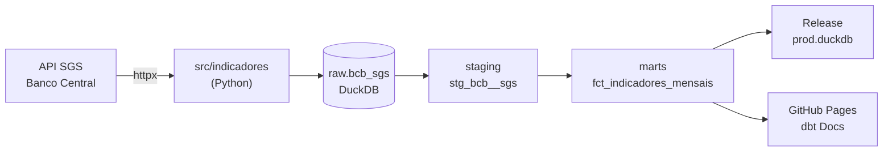
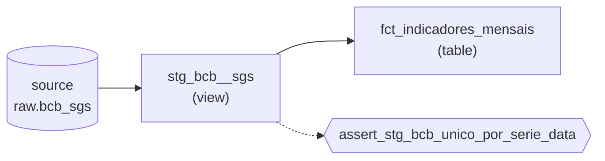

# Indicadores Econômicos do Brasil — Python + dbt + DuckDB

[](https://github.com/Jones51/indicadores-br/actions/workflows/dbt_build.yml)



Pipeline público de indicadores macroeconômicos do Brasil (Selic, IPCA e dólar PTAX), extraídos do
SGS do Banco Central, modelados com dbt e reconstruídos automaticamente a cada push.

- Ingere as séries do BCB em Python e modela em marts testados e documentados
- Publica o site de documentação e o warehouse pronto — aberto a qualquer pessoa, sem credenciais
- Roda sozinho no GitHub Actions: a cada push na `main` e toda segunda-feira

> **IBGE (SIDRA)** está planejado como segunda fonte — ver [Roadmap](#-roadmap).

| O que construí | Como implementei | Onde olhar |
| --- | --- | --- |
| **Ingestão** | extrator por fonte, parsing puro separado do HTTP, carga full idempotente por série | [`src/indicadores/`](src/indicadores/) |
| **Pipeline dbt** | sources → `staging/` → `marts/` | [`transform/models/`](transform/models/) |
| **Testes de dados** | teste de grão (`unique` / teste singular) + `not_null` nas chaves | [`_marts.yml`](transform/models/marts/_marts.yml) |
| **dbt Docs hospedado** | linhagem (inclusive por coluna), descrições, testes | [Site de docs](https://jones51.github.io/indicadores-br/) |
| **CI pública** | lint + testes + build + publicação a cada push | [Workflow](https://github.com/Jones51/indicadores-br/actions) |
| **Ambientes** | `dev` local vs `prod` na CI | [`ci/profiles.yml`](ci/profiles.yml) |
| **Warehouse publicado** | um `ATTACH`, consultável por qualquer um | [Consultar](#-consultar-o-warehouse-publicado) |
| **Decisões de arquitetura** | ADRs numerados | [`docs/adr/`](docs/adr/) |

---

## ⚙️ O pipeline dbt

As séries brutas passam por três camadas — source declarada → view de staging tipada → mart
mensal — com testes barrando cada build. O DAG completo:



| Camada | Modelo | Grão | Materialização |
| --- | --- | --- | --- |
| Source | `raw.bcb_sgs` | uma linha por (série, data), formato longo | tabela (carga Python) |
| Staging | `stg_bcb__sgs` | uma linha por (série, data), tipada | view |
| Marts | `fct_indicadores_mensais` | uma linha por mês, uma coluna por indicador | table |

Colunas do mart:

| Coluna | Descrição |
| --- | --- |
| `mes_referencia` | primeiro dia do mês (chave) |
| `selic_meta_aa` | meta Selic vigente no último dia do mês (% a.a.) |
| `ipca_mensal` | variação mensal do IPCA (%); nulo no mês corrente até a divulgação |
| `ipca_12m` | IPCA acumulado em 12 meses (%); nulo no mês corrente até a divulgação |
| `juro_real_ex_post_aa` | Selic meta descontada do IPCA 12m pela equação de Fisher (% a.a.); nulo se faltar insumo |
| `dolar_ptax_medio` | média mensal da PTAX venda (R$/US$) |
| `dolar_ptax_fim_mes` | PTAX venda do último dia útil do mês (R$/US$) |

E os recursos do dbt que fazem o trabalho:

| Recurso do dbt | Como usei |
| --- | --- |
| Sources declaradas (sem caminhos fixos no SQL) | [`_sources.yml`](transform/models/staging/_sources.yml) + `source('raw', 'bcb_sgs')`, com `freshness` de 8 dias |
| Dependências entre modelos | `ref()` em tudo a jusante; o dbt resolve ordem e paralelismo |
| Materializações | por pasta no [`dbt_project.yml`](transform/dbt_project.yml): `staging/` → `view`, `marts/` → `table` |
| Testes de dados | `unique` + `not_null` em `mes_referencia`; `accepted_values` nos nomes de série; teste singular de unicidade por (série, data) ([`assert_stg_bcb_unico_por_serie_data`](transform/tests/assert_stg_bcb_unico_por_serie_data.sql)) |
| Análise estática | `+static_analysis: strict`: SQL validado na compilação, linhagem por coluna no Docs v2 |
| Schemas customizados | macro [`generate_schema_name`](transform/macros/generate_schema_name.sql): `staging` e `marts` sem prefixo do target |
| Ambientes | `dev` local ([`transform/profiles.yml`](transform/profiles.yml)) vs `prod` na CI ([`ci/profiles.yml`](ci/profiles.yml)) |

`dbt build` compila o SQL, materializa os modelos e falha se qualquer teste falhar — o mesmo comando
local e na CI.

---

## 🚀 Produção

O GitHub Actions roda o pipeline inteiro, sem depender de máquina local:
[`.github/workflows/dbt_build.yml`](.github/workflows/dbt_build.yml)

| Gatilho | O que acontece |
| --- | --- |
| Pull request | Lint, testes e `dbt build` — valida sem publicar |
| Push na `main` | Rebuild completo + publicação |
| Semanal (segunda-feira) | Rebuild agendado — dados do BCB sempre atualizados |
| Manual (`workflow_dispatch`) | Botão "Run workflow" na aba Actions |

A cada execução na `main`, o Actions:

1. Instala as dependências com `uv` e o driver DuckDB do dbt com `dbc`
2. Roda `ruff` e `pytest`
3. Ingere as séries do BCB (`indicadores ingest`)
4. Roda `dbt build` com o profile de CI (`prod`)
5. Publica `prod.duckdb` como asset da release [`warehouse`](https://github.com/Jones51/indicadores-br/releases/tag/warehouse)
6. Gera o dbt Docs e publica no GitHub Pages

O badge no topo deste README leva às últimas execuções.

---

## 🦆 Consultar o warehouse publicado

Sem clonar nada. [Instale o DuckDB](https://duckdb.org/docs/installation/) **2.x** (o arquivo usa o
formato de armazenamento do DuckDB 2.0) — no Windows, `winget install DuckDB.cli` — e, numa sessão
`duckdb`:

```sql
INSTALL httpfs;
LOAD httpfs;

ATTACH 'https://github.com/Jones51/indicadores-br/releases/download/warehouse/prod.duckdb' AS indicadores;
USE indicadores;
SHOW ALL TABLES;

SELECT * FROM marts.fct_indicadores_mensais ORDER BY mes_referencia DESC LIMIT 12;
```

---

## 📖 Docs

A documentação é gerada com `dbt docs generate` (dbt Docs v2) e publicada no GitHub Pages:

**→ [https://jones51.github.io/indicadores-br/](https://jones51.github.io/indicadores-br/)**

O site mostra:

- O **grafo de linhagem** completo (source → staging → marts), inclusive **por coluna**
- **Descrições** de modelos e colunas vindas do YAML
- Quais colunas têm **testes**

---

## 💻 Rodar localmente

Requer [uv](https://docs.astral.sh/uv/). No PowerShell:

```powershell
uv sync                                   # cria .venv e instala dependências
uvx dbc sync --level user                 # driver DuckDB 2.x usado pelo dbt v2 (uma vez por máquina)
uv run indicadores ingest                 # extrai do BCB e carrega em data/warehouse.duckdb
cd transform
uv run dbt build --profiles-dir .         # modelos + testes (target dev)
```

Docs localmente:

```powershell
cd transform
uv run dbt compile --profiles-dir . --static-analysis strict --generate-info-schema
uv run dbt docs generate --profiles-dir . --no-compile
uv run dbt docs serve --profiles-dir . --port 8080
```

Explorar o warehouse local na UI do DuckDB (somente leitura):

```powershell
duckdb -ui -cmd "ATTACH 'data/warehouse.duckdb' AS warehouse (READ_ONLY); USE warehouse;"
```

---

## 📊 Séries

| Nome | Código SGS | Unidade | Periodicidade |
| --- | --- | --- | --- |
| `selic_meta` | 432 | % a.a. | diária |
| `ipca_mensal` | 433 | % a.m. | mensal |
| `ipca_12m` | 13522 | % 12 meses | mensal |
| `dolar_ptax_venda` | 1 | R$/US$ | diária |

Nova série = nova entrada em `SERIES_BCB` ([`config.py`](src/indicadores/config.py)).

---

## 📁 Estrutura

```text
.
├── .github/workflows/dbt_build.yml   # CI pública: lint, testes, build, publicação
├── ci/profiles.yml                   # target prod do DuckDB para o Actions
├── data/                             # warehouses locais (gitignored; a CI regenera)
├── docs/adr/                         # decisões de arquitetura (ADRs)
├── src/indicadores/
│   ├── config.py                     # caminhos e catálogo de séries
│   ├── extract/                      # um módulo por fonte (bcb, ibge)
│   ├── load.py                       # carga na camada raw
│   └── cli.py                        # `indicadores ingest`
├── tests/                            # testes unitários (sem rede)
├── transform/                        # projeto dbt
│   ├── dbt_project.yml
│   ├── models/
│   │   ├── staging/                  # _sources.yml, stg_bcb__sgs (views)
│   │   └── marts/                    # fct_indicadores_mensais + testes (tables)
│   ├── macros/                       # generate_schema_name
│   └── tests/                        # testes singulares
└── dbc.toml                          # driver ADBC do DuckDB fixado para o dbt v2
```

---

## 🗺️ Roadmap

- [x] Esqueleto: ingestão BCB, staging, mart mensal, testes
- [x] Migração para dbt v2 ([ADR 0002](docs/adr/0002-migracao-dbt-v2.md))
- [x] CI pública + warehouse na release + docs no GitHub Pages
- [ ] Extrator IBGE (desemprego PNAD, PIB)
- [ ] Ingestão incremental (só baixa o que falta)
- [ ] Análise: correlação Selic × IPCA com defasagem
- [ ] Dashboard HTML interativo
