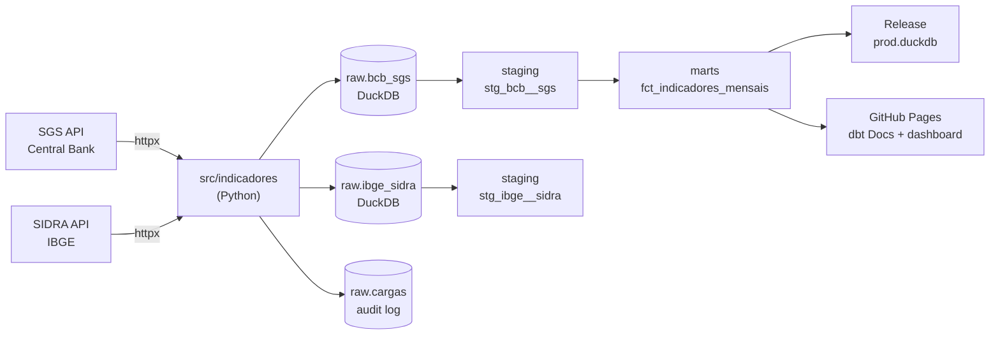
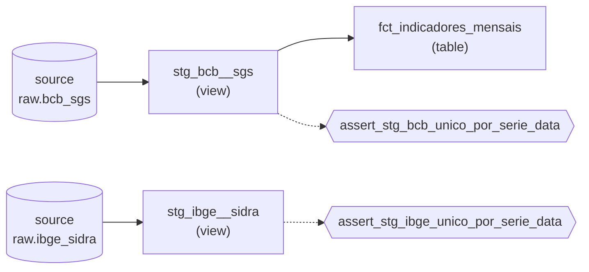
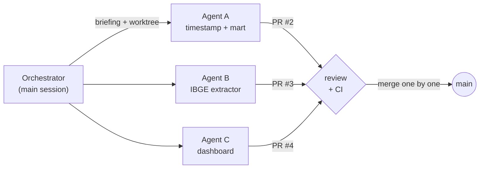

# Brazil Economic Indicators Pipeline — Python + dbt + DuckDB

[](https://github.com/Jones51/indicadores-br/actions/workflows/dbt_build.yml)



A public pipeline of Brazilian macroeconomic indicators (Selic policy rate, IPCA inflation and the
PTAX USD/BRL rate), extracted from the Central Bank's SGS API, modeled with dbt and refreshed
automatically on every push — with incremental ingestion reconciled weekly against a full reload.

- Ingests the Central Bank (BCB) and IBGE series in Python and models them into tested, documented marts
- Publishes the docs site, a dashboard and the finished warehouse — open to anyone, no credentials
- Runs itself on GitHub Actions: every push to `main` and every Monday

> **IBGE (SIDRA)** is already ingested up to the staging layer (PNAD unemployment and quarterly GDP,
> [ADR 0004](docs/adr/0004-extrator-ibge-sidra.md)); joining it into the mart is on the [Roadmap](#-roadmap).

> **Language note:** documentation is in English; domain identifiers (tables, columns, functions,
> CLI) are kept in Portuguese, matching the source data and the project's conventions
> ([`CLAUDE.md`](CLAUDE.md)). ADRs are in Portuguese.

## 🎯 Business problem

Tracking Selic, inflation and the exchange rate usually means downloading series by hand from different official sources, and trusting that nothing was revised. This project automates ingestion, tests the data and publishes a single warehouse and dashboard.

## ✅ Results

- Public [dashboard](https://jones51.github.io/indicadores-br/dashboard/), [dbt docs](https://jones51.github.io/indicadores-br/) and DuckDB warehouse, no credentials needed
- Runs on GitHub Actions on pushes to `main` and every Monday
- Weekly full reload reconciles the incremental load

## 🧰 What I built

| What I Built | How I Implemented | Where to Look |
| --- | --- | --- |
| **Ingestion** | one extractor per source, pure parsing split from HTTP, **incremental** load with a revision margin — idempotent and audited | [`src/indicadores/`](src/indicadores/) · [ADR 0006](docs/adr/0006-ingestao-incremental.md) |
| **Data safety** | validated state, weekly "full wins" reconciliation, dbt quality gate, warehouse backup and rollback | [Production](#-production) |
| **dbt pipeline** | sources → `staging/` → `marts/` | [`transform/models/`](transform/models/) |
| **Data tests** | grain tests (`unique` / singular test) + `not_null` on keys | [`_marts.yml`](transform/models/marts/_marts.yml) |
| **Hosted dbt docs** | lineage (including column-level), descriptions, tests | [Live docs site](https://jones51.github.io/indicadores-br/) |
| **Public dashboard** | static HTML + D3, fed by a JSON the CI exports from the mart | [Dashboard](https://jones51.github.io/indicadores-br/dashboard/) |
| **Public CI** | lint + tests + build + publish on every push; `main` is protected (PR + green CI required) | [Actions workflow](https://github.com/Jones51/indicadores-br/actions) |
| **Environments** | local `dev` vs CI `prod` targets | [`ci/profiles.yml`](ci/profiles.yml) |
| **Published warehouse** | one `ATTACH`, queryable by anyone | [Query it](#-query-the-published-warehouse) |
| **Architecture decisions** | numbered ADRs | [`docs/adr/`](docs/adr/) |
| **Parallel agents** | Claude Code subagents in git worktrees (Orca IDE), one PR per agent, reviewed integration | [How it was done](#-parallel-agent-development) |

---

## ⚙️ The dbt Pipeline

Raw series flow through three layers — declared sources → typed staging views → monthly mart —
with tests gating every build. The full DAG:



| Layer | Model | Grain | Materialization |
| --- | --- | --- | --- |
| Source | `raw.bcb_sgs` | one row per (series, date), long format | table (Python load) |
| Source | `raw.ibge_sidra` | one row per (series, period), long format | table (Python load) |
| Source | `raw.cargas` | one row per (run, series, mode): ingestion audit log | table (Python load) |
| Source | `raw.reconciliacoes` | one row per (run, series): incremental × full reconciliation | table (Python load) |
| Staging | `stg_bcb__sgs` | one row per (series, date), typed | view |
| Staging | `stg_ibge__sidra` | one row per (series, date), typed | view |
| Seed | `seeds.metas_inflacao` | one row per year: CMN inflation target and tolerance ([ADR 0007](docs/adr/0007-metas-inflacao-seed.md)) | table (`dbt seed`) |
| Marts | `fct_indicadores_mensais` | one row per month, one column per indicator | table |

Mart columns:

| Column | Description |
| --- | --- |
| `mes_referencia` | first day of the reference month (key) |
| `selic_meta_aa` | Selic target rate in force on the last day of the month (% p.a.) |
| `ipca_mensal` | monthly IPCA inflation (%); null for the current month until released |
| `ipca_12m` | 12-month accumulated IPCA (%); null for the current month until released |
| `juro_real_ex_post_aa` | Selic deflated by 12-month IPCA via the Fisher equation (% p.a.); null if an input is missing |
| `dolar_ptax_medio` | monthly average of the PTAX selling rate (BRL per USD) |
| `dolar_ptax_fim_mes` | PTAX selling rate on the last business day of the month (BRL per USD) |
| `meta_inflacao` | CMN inflation target in force in the month's year (%); since 2025 the continuous 3.00% target |
| `meta_inflacao_inferior` / `meta_inflacao_superior` | floor and ceiling of the tolerance band (target ∓ tolerance, %) |
| `status_meta_inflacao` | 12-month IPCA vs. the band: `acima` (above), `dentro` (within), `abaixo` (below); null until IPCA is released |
| `meses_seguidos_status_meta` | consecutive months, ending in this one, with the same status |

And the dbt features doing the work:

| dbt Feature | How I Used It |
| --- | --- |
| Declared sources (no hardcoded paths in SQL) | [`_sources.yml`](transform/models/staging/_sources.yml) + `source('raw', 'bcb_sgs')`, with an 8-day `freshness` check |
| Model dependencies | `ref()` everywhere downstream; dbt resolves order and parallelism |
| Materializations | set per folder in [`dbt_project.yml`](transform/dbt_project.yml): `staging/` → `view`, `marts/` → `table` |
| Seeds | [`metas_inflacao.csv`](transform/seeds/metas_inflacao.csv): reference data kept by hand, typed with `column_types` and tested like a model |
| Data tests | `unique` + `not_null` on `mes_referencia`; `accepted_values` on series names and target status; seed range/contiguity test; singular uniqueness tests per (series, date) ([`assert_stg_bcb_unico_por_serie_data`](transform/tests/assert_stg_bcb_unico_por_serie_data.sql)) |
| Static analysis | `+static_analysis: strict`: SQL validated at compile time, column-level lineage in Docs v2 |
| Custom schemas | [`generate_schema_name`](transform/macros/generate_schema_name.sql) macro: `staging`, `marts` and `seeds` without the target prefix |
| Environments | local `dev` ([`transform/profiles.yml`](transform/profiles.yml)) vs CI `prod` ([`ci/profiles.yml`](ci/profiles.yml)) |

`dbt build` compiles SQL, materializes models, and fails the run if any test fails — same command
locally and in CI.

---

## 🚀 Production

GitHub Actions runs the whole pipeline — no laptop required:
[`.github/workflows/dbt_build.yml`](.github/workflows/dbt_build.yml). The CI is **stateful**: the
`prod.duckdb` published on the release is the starting point of the next run
([ADR 0006](docs/adr/0006-ingestao-incremental.md)).

| Trigger | Ingestion | "Full wins" reconciliation | Publishes |
| --- | --- | --- | --- |
| Pull request | incremental on top of `prod.duckdb` (read-only) | yes (exercises the scheduled path) | no |
| Push to `main` | incremental | no | yes |
| Weekly (Monday) | incremental | **yes**: the full load is published | yes |
| Manual (`workflow_dispatch`) | `modo: incremental` or `full` | if `reconciliar` is checked | yes |

On each run, Actions:

1. Installs deps (`uv`, `dbc` driver) and runs `ruff` and `pytest`
2. **Downloads and validates the state** (`indicadores validar`): to serve as an incremental base,
   the release's `prod.duckdb` must open in DuckDB, have the raw tables with the expected schema
   and no duplicate keys. If it **opens but is invalid** (e.g. a schema from a previous code
   version), the load becomes full, the new database inherits the audit history and the file is
   still kept as the backup. If it is **corrupted**, the load becomes full and the existing backup
   is preserved. If the release has no file, each series falls back to full on its own. If the
   release lookup itself fails, the run stops
3. **Ingests** (`indicadores ingest`): each series restarts a little before its last loaded date
   (90 days for daily series, 2 periods for monthly and quarterly ones) and replaces that window,
   in a transaction that also writes the audit row to `raw.cargas`
4. **Reconciles** (Mondays and PRs): a full load into a separate database, compared series by
   series and row by row (`indicadores reconciliar`). Source revisions are logged and the full
   load wins. Structural divergence (a series disappeared, a date went backwards, a row count
   dropped more than 1%) **fails the run**
5. **Quality gate**: `dbt build` and `dbt source freshness` must pass
6. **Publishes** (only on `main`): uploads the previous `prod.duckdb` as `prod.anterior.duckdb`
   (backup), then the new `prod.duckdb`, to the [`warehouse`](https://github.com/Jones51/indicadores-br/releases/tag/warehouse) release
7. Generates the dbt Docs and the dashboard (`indicadores exportar`) and deploys them to GitHub Pages

If any step before publishing fails, the published warehouse stays as it was.

### Following a run

The **run summary** (the run's *Summary* tab in Actions) shows the initial state used, a table per
series (mode, reason, last date before → after, rows received, deleted and inserted) and, when
there is a reconciliation, its report with sample divergent rows. The badge at the top of this
README links to the latest runs.

The history lives in the published warehouse itself:

```sql
-- latest runs: mode and volume per source
SELECT execucao_id, fonte, modo, motivo, count(*) AS series,
       sum(linhas_recebidas) AS recebidas, max(executado_em) AS executado_em
FROM raw.cargas
GROUP BY ALL
ORDER BY executado_em DESC
LIMIT 20;

-- divergences found by the weekly reconciliation
SELECT execucao_id, serie_nome, situacao, detalhe
FROM raw.reconciliacoes
WHERE situacao <> 'igual'
ORDER BY executado_em DESC;
```

### Warehouse rollback

Every publish keeps the previous version as `prod.anterior.duckdb` on the same release:

| Previous `prod.duckdb` | `validar` exit | Backup |
| --- | --- | --- |
| valid | 0 | becomes `prod.anterior.duckdb` |
| opens, but invalid as a base (e.g. schema from a previous code version) | 3 | **becomes** `prod.anterior.duckdb`: it was published after passing `dbt build` |
| corrupted (doesn't open in DuckDB) | 4 | no; the existing `prod.anterior.duckdb` is preserved |

To roll back to the previous version (requires `gh` authenticated with write access to the repo):

```powershell
gh release download warehouse -p prod.anterior.duckdb -O prod.duckdb --clobber
uv run indicadores validar --db prod.duckdb      # 0 or 3: opens; 4: corrupted, don't publish
gh release upload warehouse prod.duckdb --clobber
```

Restoring an old-schema backup (exit 3) is safe: the next run does a full load, inherits the
`raw.cargas`/`raw.reconciliacoes` history and keeps that same file as the backup. With exit 0, the
next run starts from the restored warehouse. The dbt Docs and dashboard on Pages keep the last
run's version until the next one, which can be triggered from the Actions tab (*Run workflow*).
Use `modo: full` to rebuild from scratch.

---

## 🦆 Query the published warehouse

No clone required. [Install DuckDB](https://duckdb.org/docs/installation/) **2.x** (the file uses
the DuckDB 2.0 storage format) — on Windows, `winget install DuckDB.cli` — then from a `duckdb`
session:

```sql
INSTALL httpfs;
LOAD httpfs;

ATTACH 'https://github.com/Jones51/indicadores-br/releases/download/warehouse/prod.duckdb' AS indicadores;
USE indicadores;
SHOW ALL TABLES;

SELECT * FROM marts.fct_indicadores_mensais ORDER BY mes_referencia DESC LIMIT 12;
```

---

## 📖 Docs

Docs are generated with `dbt docs generate` (dbt Docs v2) and published to GitHub Pages:

**→ [https://jones51.github.io/indicadores-br/](https://jones51.github.io/indicadores-br/)**

The site shows:

- The full **lineage graph** (sources → staging → marts), including **column-level** lineage
- **Model and column descriptions** from the YAML
- Which columns carry **tests**

The **dashboard** (KPI cards with 24-month sparklines, key alerts, Selic × IPCA against the
inflation target band, monthly IPCA and USD/BRL) is published on
the same site, from a JSON exported from the mart by the CI ([ADR 0005](docs/adr/0005-dashboard-estatico-pages.md)):

**→ [https://jones51.github.io/indicadores-br/dashboard/](https://jones51.github.io/indicadores-br/dashboard/)**

---

## 💻 Run it yourself

Requires [uv](https://docs.astral.sh/uv/). In PowerShell:

```powershell
uv sync                                   # create .venv and install dependencies
uvx dbc sync --level user                 # DuckDB 2.x driver used by dbt v2 (once per machine)
uv run indicadores ingest                 # incremental: only each series' recent window (empty db = full)
uv run indicadores ingest --full          # full reload since 2010
cd transform
uv run dbt build --profiles-dir .         # models + tests (dev target)
```

Optional docs locally:

```powershell
cd transform
uv run dbt compile --profiles-dir . --static-analysis strict --generate-info-schema
uv run dbt docs generate --profiles-dir . --no-compile
uv run dbt docs serve --profiles-dir . --port 8080
```

Dashboard locally (open http://localhost:8000):

```powershell
uv run indicadores exportar                    # writes dashboard/dados.json from the mart
uv run python -m http.server -d dashboard 8000
```

State validation and reconciliation, with the same commands the CI uses:

```powershell
uv run indicadores validar --db data/warehouse.duckdb    # 0 valid, 3 opens but invalid, 4 corrupted
$env:DUCKDB_PATH = "data/full.duckdb"; uv run indicadores ingest --full; Remove-Item Env:DUCKDB_PATH
uv run indicadores reconciliar --base data/warehouse.duckdb --full data/full.duckdb   # 2 = structural
uv run indicadores resumo                                # table of the latest run in raw.cargas
```

Explore the local warehouse in the DuckDB UI (read-only):

```powershell
duckdb -ui -cmd "ATTACH 'data/warehouse.duckdb' AS warehouse (READ_ONLY); USE warehouse;"
```

---

## 📊 Series

Central Bank (BCB SGS):

| Name | SGS code | Unit | Frequency |
| --- | --- | --- | --- |
| `selic_meta` | 432 | % p.a. | daily |
| `ipca_mensal` | 433 | % per month | monthly |
| `ipca_12m` | 13522 | % 12 months | monthly |
| `dolar_ptax_venda` | 1 | BRL per USD | daily |

IBGE (SIDRA), Brazil level. Dates = first day of the period's last month
([ADR 0004](docs/adr/0004-extrator-ibge-sidra.md)):

| Name | Table / variable | Unit | Frequency |
| --- | --- | --- | --- |
| `desocupacao` | 4099 / 4099 | % | quarterly |
| `desocupacao_movel` | 6381 / 4099 | % | rolling quarter (monthly) |
| `pib_indice_sa` | 1621 / 584 (GDP at market prices) | seasonally adjusted index (1995=100) | quarterly |
| `pib_var_interanual` | 5932 / 6561 (GDP at market prices) | % vs. same quarter of the previous year | quarterly |

A new series = a new entry in `SERIES_BCB` or `SERIES_IBGE` ([`config.py`](src/indicadores/config.py)).
`uv run indicadores ingest --fonte ibge` ingests a single source.

---

## 📁 Project layout

```text
.
├── .github/workflows/dbt_build.yml   # public CI: lint, tests, build, publish
├── ci/profiles.yml                   # prod DuckDB target for Actions
├── dashboard/index.html              # static dashboard (reads dados.json exported from the mart)
├── data/                             # local warehouses (gitignored; CI regenerates)
├── docs/adr/                         # architecture decision records (ADRs)
├── src/indicadores/
│   ├── config.py                     # paths and series catalog
│   ├── extract/                      # one module per source (bcb, ibge)
│   ├── incremental.py                # incremental window (pure functions)
│   ├── ingestao.py                   # orchestrates window -> extract -> load + audit
│   ├── load.py                       # raw load (range replacement) and raw.cargas
│   ├── estado.py                     # inherited warehouse validation (`indicadores validar`)
│   ├── reconciliar.py                # incremental x full reconciliation
│   └── cli.py                        # `indicadores ingest | validar | reconciliar | resumo | exportar`
├── tests/                            # unit tests (no network)
├── transform/                        # dbt project
│   ├── dbt_project.yml
│   ├── seeds/                        # metas_inflacao.csv (CMN inflation targets)
│   ├── models/
│   │   ├── staging/                  # _sources.yml, stg_bcb__sgs, stg_ibge__sidra (views)
│   │   └── marts/                    # fct_indicadores_mensais + tests (tables)
│   ├── macros/                       # generate_schema_name
│   └── tests/                        # singular tests
└── dbc.toml                          # pinned DuckDB ADBC driver for dbt v2
```

---

## 🤖 Parallel agent development

This project is also a study in **agentic development**, built in the
[Orca](https://github.com/stablyai/orca) IDE: several features were built by Claude
Code subagents working **at the same time**, each in its own
[git worktree](https://git-scm.com/docs/git-worktree) and branch, with an orchestrator agent
planning, reviewing and integrating. The full process is in [`CLAUDE.md`](CLAUDE.md#desenvolvimento-com-agentes-em-paralelo) (in Portuguese).



| Stage | How it was done |
| --- | --- |
| **Planning** | tasks split by code area, with a conflict map and reserved ADR numbers |
| **Isolation** | one worktree per agent, next to the repo (`..\indicadores-br.worktrees\<branch>`), with its own `.venv` and warehouse |
| **Data** | each worktree seeded with the production snapshot (`prod.duckdb` from the release), like a prod *clone* |
| **Delivery** | each agent validates (pytest, ruff, `dbt build`), opens the PR and waits for CI — no merging |
| **Integration** | dry run with `git merge-tree`, merge one PR at a time, `git merge origin/main` into the next branch |
| **Review loop** | review findings go back to the **same** agent (it keeps its context), as new commits — no history rewrite after review |

**Wave 1** — 3 agents in parallel, 3 PRs, 1 textual and 1 semantic conflict:

| PR | Agent | Delivery | Integration |
| --- | --- | --- | --- |
| [#2](https://github.com/Jones51/indicadores-br/pull/2) | A | timezone-aware `extraido_em`, current month in the mart, load tests | clean merge |
| [#3](https://github.com/Jones51/indicadores-br/pull/3) | B | IBGE (SIDRA) extractor up to staging ([ADR 0004](docs/adr/0004-extrator-ibge-sidra.md)) | textual conflict in `load.py` + **semantic** conflict (a new table carrying the bug #2 had fixed) |
| [#4](https://github.com/Jones51/indicadores-br/pull/4) | C | dashboard + JSON export ([ADR 0005](docs/adr/0005-dashboard-estatico-pages.md)) | no conflict; revalidated on top of the new `main` (current month with null IPCA) |

**Wave 2** — 1 agent, 1 PR, 1 review round:

| PR | Delivery | Review |
| --- | --- | --- |
| [#6](https://github.com/Jones51/indicadores-br/pull/6) | incremental ingestion, audit log, weekly reconciliation, backup/rollback ([ADR 0006](docs/adr/0006-ingestao-incremental.md)) | the review found that a schema change would skip the backup and drop the audit history; sent back to the same agent and fixed in 5 new commits |

The lesson: git only flags **textual** conflicts. The one in PR #3 passed cleanly through git and
CI and only showed up in review — and it became a test that enforces the pattern from then on.

---

## 🗺️ Roadmap

- [x] Skeleton: BCB ingestion, staging, monthly mart, tests
- [x] Migration to dbt v2 ([ADR 0002](docs/adr/0002-migracao-dbt-v2.md))
- [x] Public CI + warehouse on the release + docs on GitHub Pages
- [x] IBGE extractor (PNAD unemployment, GDP) up to staging ([ADR 0004](docs/adr/0004-extrator-ibge-sidra.md))
- [ ] IBGE in the monthly mart
- [x] Incremental ingestion with weekly reconciliation, backup and audit log ([ADR 0006](docs/adr/0006-ingestao-incremental.md))
- [ ] Analysis: Selic × IPCA cross-correlation with lags
- [x] Interactive HTML dashboard ([ADR 0005](docs/adr/0005-dashboard-estatico-pages.md))
- [x] Parallel agent development process documented
- [x] Protected `main` branch (PR + green CI required)
